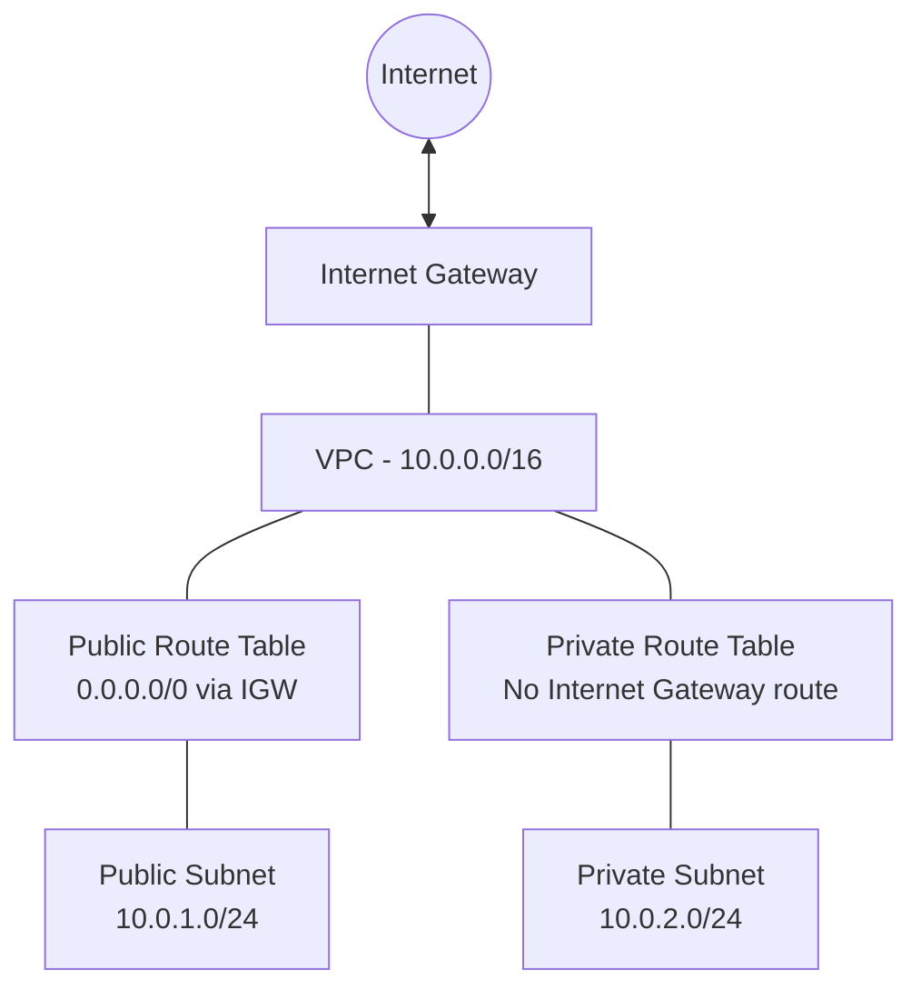

# AWS Infrastructure Provisioning with Terraform

## Project Overview

This project demonstrates Infrastructure as Code (IaC) by provisioning foundational AWS networking resources using Terraform in the Mumbai region (`ap-south-1`).

The project creates an Amazon VPC with public and private subnets, an Internet Gateway, separate route tables, and subnet associations. Terraform manages these resources declaratively, making infrastructure easier to reproduce, review, and maintain.

## Architecture



**Network design:**
- The VPC uses the CIDR range `10.0.0.0/16`.
- The public subnet uses `10.0.1.0/24` and has a default IPv4 route through the Internet Gateway.
- The private subnet uses `10.0.2.0/24` and has a separate route table without a route through an Internet Gateway or NAT Gateway.
- A public IP assignment setting is enabled for instances launched in the public subnet. Actual internet connectivity also depends on security rules and other network configuration.
- No EC2 instances, NAT Gateway, or application workloads are provisioned by this project.

## AWS Resources

| Resource | Purpose |
|---|---|
| Amazon VPC | Provides an isolated virtual network |
| Public subnet | Subnet configured for public routing |
| Private subnet | Subnet without a direct Internet Gateway route |
| Internet Gateway | Provides an internet gateway attachment to the VPC |
| Public route table | Routes `0.0.0.0/0` through the Internet Gateway |
| Private route table | Provides separate routing for the private subnet |
| Public route table association | Associates the public subnet with its route table |
| Private route table association | Associates the private subnet with its route table |

## Technology Stack

- Amazon Web Services (AWS)
- Terraform
- AWS CLI
- Git and GitHub
- Visual Studio Code
- Windows PowerShell

## Project Structure

```text
aws-infrastructure-terraform/
├── .gitignore
├── .terraform.lock.hcl
├── README.md
├── main.tf
├── outputs.tf
├── providers.tf
└── variables.tf
```

Terraform may generate additional local files, such as state files and the `.terraform/` working directory. These should not be committed to GitHub.

## Prerequisites

1. An AWS account with appropriately scoped IAM permissions.
2. Terraform installed.
3. AWS CLI installed and configured.
4. Git installed.
5. An AWS CLI profile configured locally for Terraform.

The provider configuration in this repository uses the AWS CLI profile named `terraform-user`. Configure that profile on your own machine or update `providers.tf` to use your preferred AWS authentication method.

Never store AWS access keys or secret keys in Terraform files or commit them to GitHub.

## Setup and Deployment

### 1. Clone the repository

```bash
git clone https://github.com/vishwakarmasuman/aws-infrastructure-terraform.git
cd aws-infrastructure-terraform
```

### 2. Initialize Terraform

```bash
terraform init
```

### 3. Format and validate the configuration

```bash
terraform fmt
terraform validate
```

### 4. Review the planned changes

```bash
terraform plan
```

Review the plan carefully before creating or changing any AWS resources.

### 5. Deploy the infrastructure

```bash
terraform apply
```

Review the proposed actions and confirm only when they match your expectations.

### 6. View the outputs

```bash
terraform output
```

The configuration provides the VPC ID and the public and private subnet IDs.

## Cleanup

To preview the resources Terraform intends to remove:

```bash
terraform plan -destroy
```

If you intend to delete the infrastructure managed by this configuration:

```bash
terraform destroy
```

Review the proposed deletions before confirming. Do not run these commands against shared or production infrastructure without authorization.

## Security and Cost Considerations

- Use least-privilege IAM permissions.
- Keep AWS credentials outside the repository.
- Do not commit Terraform state files, saved plans, secret variable files, or private keys.
- Review AWS pricing and account-specific Free Tier eligibility before deployment.
- The listed networking resources generally have no direct hourly charge, but related services and additional resources may incur charges.
- The private subnet has no NAT Gateway configured, so this configuration does not provide NAT-based outbound internet access.
- Restrict inbound traffic when adding workloads and security groups.

## Learning Outcomes

- Infrastructure as Code using Terraform.
- AWS VPC and subnet design.
- Public and private route table configuration.
- Internet Gateway integration.
- Terraform initialization, validation, planning, deployment, and outputs.
- Git-based version control and project documentation.
- Basic cloud security and cost awareness.

## Author

**Suman Vishwakarma**

GitHub: [@vishwakarmasuman](https://github.com/vishwakarmasuman)

*This is a learning and portfolio project. Review Terraform plans, permissions, security requirements, and potential AWS charges before deploying infrastructure.*