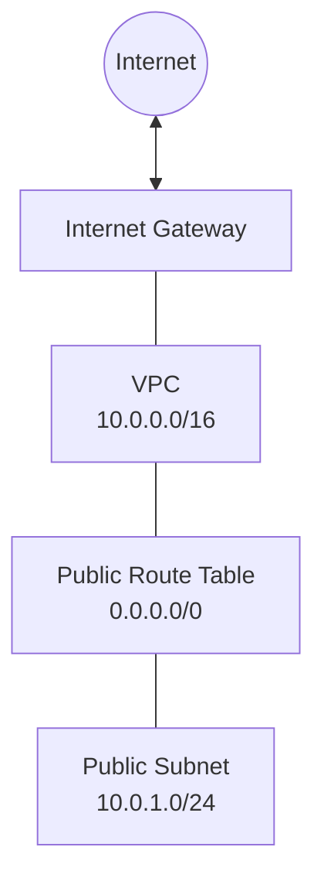

# AWS Infrastructure Provisioning with Terraform

## Project Overview

This project demonstrates Infrastructure as Code (IaC) by using Terraform to provision a foundational AWS network infrastructure in the Mumbai region (`ap-south-1`).

The infrastructure includes an Amazon VPC, a public subnet, an Internet Gateway, a public route table, and a route table association. Resources are defined declaratively so that the infrastructure can be reviewed, version-controlled, and managed consistently.

## Architecture



The Internet Gateway and default route provide an internet route for the public subnet. This does not, by itself, expose a workload to the internet; additional resources and security rules would be needed.

## AWS Resources

| Resource | Configuration |
|---|---|
| Amazon VPC | `10.0.0.0/16` |
| Public subnet | `10.0.1.0/24` |
| AWS Region | `ap-south-1` |
| Internet Gateway | Attached to the VPC |
| Public route table | Default IPv4 route through the Internet Gateway |
| Route table association | Associates the route table with the public subnet |

## Technology Stack

- AWS
- Terraform
- AWS CLI
- Git and GitHub
- Visual Studio Code
- PowerShell

## Prerequisites

1. An AWS account with appropriately scoped IAM permissions.
2. Terraform installed on your local machine.
3. AWS CLI installed and configured.
4. Git installed and connected to your GitHub account.

Do not store AWS credentials in Terraform files or commit credentials, state files, or secret variable files to GitHub.

## Project Structure

```text
aws-infrastructure-terraform/
├── .gitignore
├── providers.tf
├── main.tf
├── variables.tf
├── outputs.tf
└── README.md
```

Terraform may also generate `terraform.lock.hcl`. Commit that file to version control to preserve provider selections.

## Setup and Validation

Clone the repository:

```bash
git clone https://github.com/vishwakarmasuman/aws-infrastructure-terraform.git
cd aws-infrastructure-terraform
```

Initialize Terraform:

```bash
terraform init
```

Format and validate the configuration:

```bash
terraform fmt
terraform validate
```

Preview proposed changes:

```bash
terraform plan
```

Review the plan carefully before provisioning any resources.

## Deployment

Only after reviewing the plan, permissions, and potential AWS charges, deploy with:

```bash
terraform apply
```

Review the proposed actions and confirm only if they are expected.

Retrieve the outputs:

```bash
terraform output
```

## Cleanup

When you no longer need the infrastructure, review the resources Terraform intends to remove:

```bash
terraform plan -destroy
```

If the plan is correct and you want to remove the resources managed by this configuration:

```bash
terraform destroy
```

Review the plan and confirm before proceeding. Do not run destroy against shared or production infrastructure.

## Security and Cost Considerations

- Use least-privilege IAM permissions.
- Never commit access keys, secret keys, Terraform state, or sensitive variable files.
- Review the AWS pricing and Free Tier eligibility for your account.
- A VPC, subnet, route table, and Internet Gateway generally have no direct hourly charge, but other resources or related services may incur costs.
- Keep the AWS region and resource tags consistent.
- Do not deploy workloads with unrestricted inbound security-group rules.

## Learning Outcomes

- Infrastructure as Code using Terraform.
- AWS VPC and subnet fundamentals.
- Internet Gateway and route table configuration.
- Terraform initialization, validation, planning, and outputs.
- Version control and project documentation with Git and GitHub.
- Basic cloud security and cost awareness.

## Author

**Suman Vishwakarma**

GitHub: [@vishwakarmasuman](https://github.com/vishwakarmasuman)

*This is a learning and portfolio project. Review the Terraform plan, security requirements, and AWS costs before deploying it.*